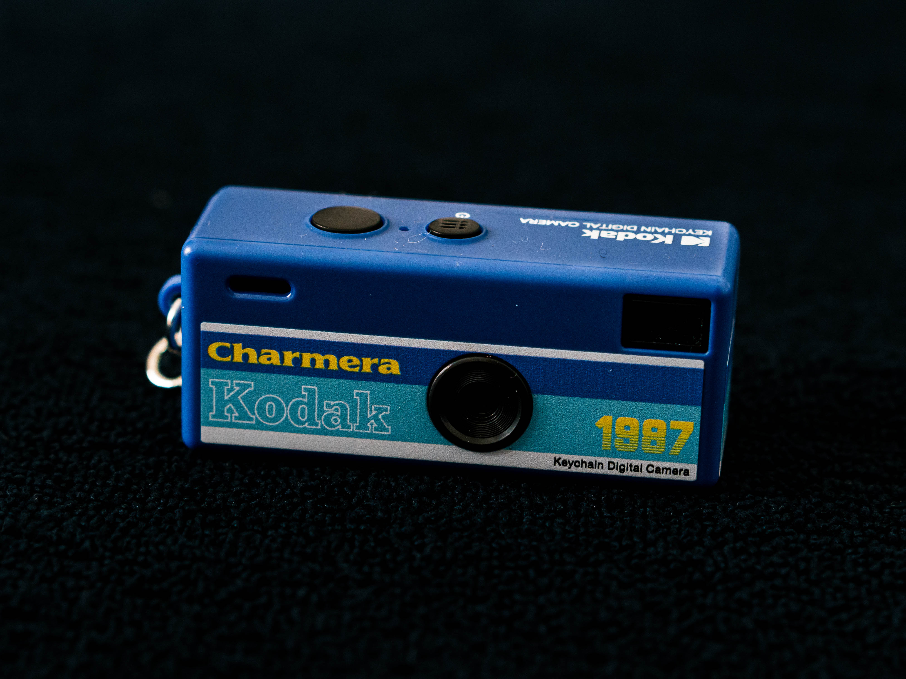
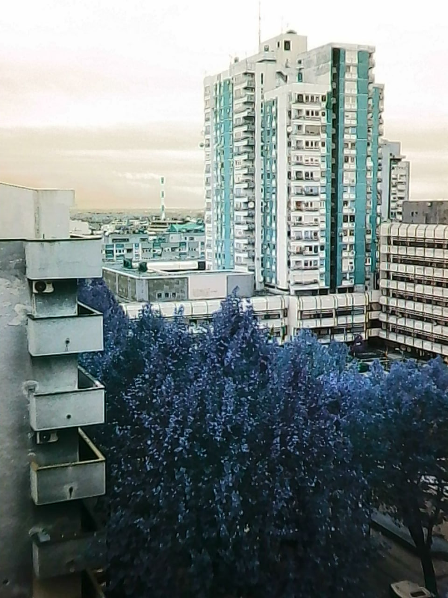
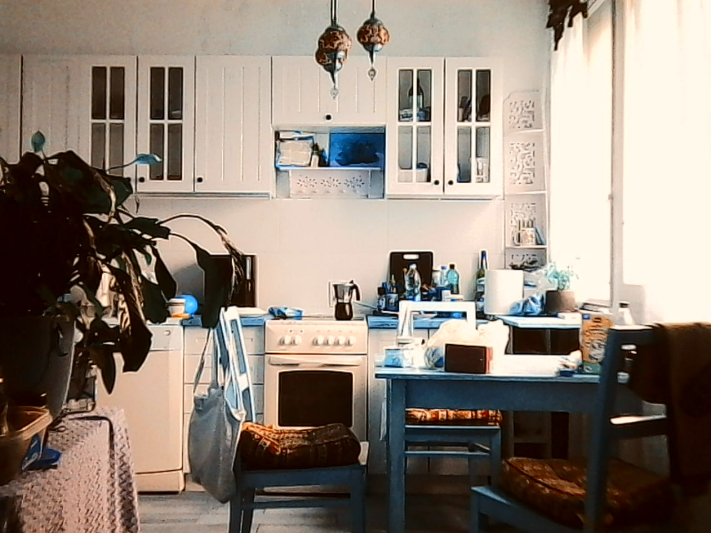

# ChromaCrank for Kodak Charmera

**Color experiments and firmware research for the Kodak Charmera.**

ChromaCrank explores color rendering, tone curves and JPEG compression on the
Kodak Charmera. It also investigates shutter delay and problems with saving photos.

The aim is to give Charmera owners more control over the images they make.
Once changes are validated, the project plans to provide installation instructions
that an AI agent can walk you through.

  

Camera photo: [Ryohei Noda](https://www.flickr.com/photos/g4gti/54970475299/),
via [Wikimedia Commons](https://commons.wikimedia.org/w/index.php?title=File:Kodak_Charmera_(54970475299).jpg),
[CC BY 4.0](https://creativecommons.org/licenses/by/4.0/). Original file, unchanged.

## What is here

This repository brings together image examples, firmware findings and a guide for
exploring the project with an AI agent. You can:

- **Explore the image experiments** and see which changes are being investigated.
- **Get help from your AI agent** to understand the findings, check for releases
  and work out whether an update supports your camera. A prompt is included below.
- **Build on the research** using the JPEG presets, capture events, filesystem
  findings and USB notes in [RESEARCH.md](RESEARCH.md). Reference hashes and
  offsets help you pick up the investigation without starting from scratch.

## Image examples

  
  

Two image examples, not a controlled before-and-after comparison.

## Current work

| Area | Progress |
|---|---|
| **Color and tone** | Experimental color profiles and tone curves have been developed. They are not a validated release; compatibility across camera variants remains unverified |
| **JPEG** | Stock quantization tables and quality presets have been investigated. Higher quality needs testing through the complete photo capture path |
| **Capture speed** | Parts of the firmware event and delay paths have been mapped. No speed improvement has been demonstrated on a camera |
| **Photo storage** | Filesystem defects have been identified; fixes are being tested under laboratory conditions |

[RESEARCH.md](RESEARCH.md) records what was found, how it was checked and what
remains unresolved.

## Download and installation

**This project is in the research stage. There is no validated firmware release
available for end-user installation yet.**

Firmware binaries and research tools are not included in this repository.
See [INSTALL.md](INSTALL.md) for installation availability and
[releases.json](releases.json) for the release catalog.

## Use with an AI agent

Give your agent this repository's URL and the following request:

> Help me understand ChromaCrank for my Kodak Charmera. Read README.md, AGENTS.md
> and INSTALL.md, and check the available releases. Explain what the project can
> do today and whether an update supports my camera. If a validated release is
> available, guide me through its installation instructions. Ask for my agreement
> before writing anything to the card. If there is no validated release, stop
> and explain that installation is unavailable; do not substitute experimental firmware.

[AGENTS.md](AGENTS.md) tells the agent how to check releases and compatibility
before suggesting an update.

## Contributing

To investigate the firmware, start with [RESEARCH.md](RESEARCH.md).
When reporting a problem, include the camera model and variant, firmware version,
reproduction steps, and expected versus actual behavior. If the version is unknown,
say so. Do not attach private dumps, photo archives or credentials.

---

An independent experimental project. Not affiliated with Kodak and not an official
manufacturer firmware update.
